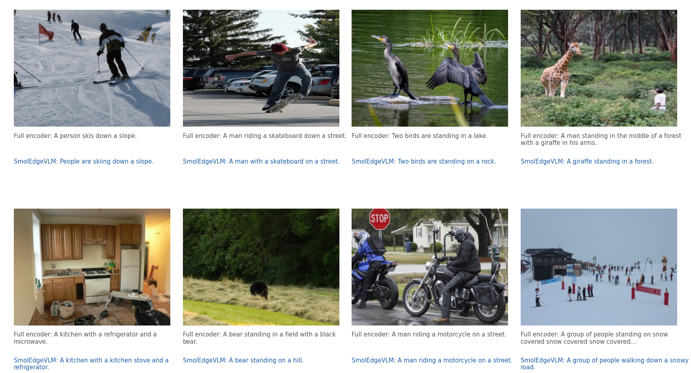
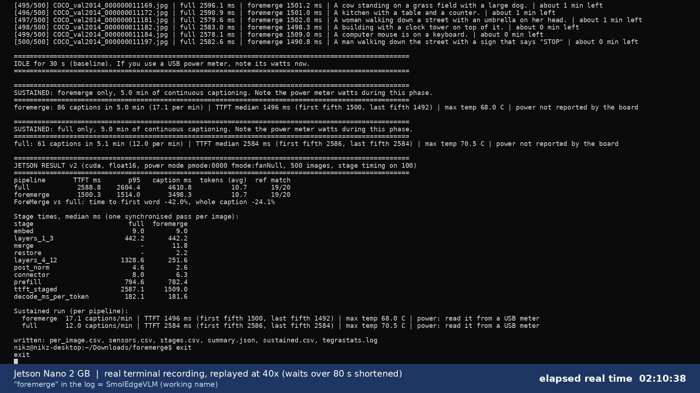

# SmolEdgeVLM: Low-Latency Image Captioning on a 2 GB Edge Device

SmolEdgeVLM cuts the time a small vision-language model takes to start captioning an image by reducing work
**inside a frozen vision encoder**, then repairing the merged features with a tiny module trained without captions.
It runs on a **Jetson Nano 2 GB**.

| Headline result | Full encoder | SmolEdgeVLM | Change |
|---|---|---|---|
| Time to first token, Jetson Nano 2 GB (10 W, 500 images) | 2.52 s | **1.46 s** | **−42%** |
| Time to first token, Tesla T4 (500 images, 3 seeds) | 113.2 ms | **71.7 ms** | **−37%** |
| Caption quality, T4 (CIDEr-D / CLIPScore, 3 seeds) | 0.791 / 69.0 | 0.786 / 69.3 | no significant difference |
| Captions per minute, Jetson (5-minute sustained run) | 12.5 | **17.3** | +38% |
| Trained parameters | | 1.08 M (0.47% of 229 M) | encoder and language model stay frozen |

<p align="center"></p>

---

## Situation

Compact vision-language models are small enough for low-cost edge boards, but they are slow to *start* answering.
On a Jetson Nano 2 GB, a SigLIP + SmolLM2 captioning pipeline waits **2.5 s before the first token** of a
caption appears, and **about 70% of that wait is the vision encoder**. In the released SmolVLM-256M the encoder is
**89% of the time to first token** (Tesla T4, 13 image tiles).

Most token-reduction methods remove visual tokens *after* the encoder (PruMerge, VisionZip) or *inside* the language
model (FastV), so the encoder's own cost stays. Merging tokens early inside the encoder does remove that cost, but
caption quality drops.

## Task

Reduce the vision encoder's latency on a 2 GB edge device:

- without retraining the vision encoder or the language model,
- while keeping caption quality close to the full encoder,
- and verify the gain on the real device, not only on a server GPU.

## Action

### 1. Pipeline

```mermaid
flowchart LR
    A["Image<br/>3×512×512"] --> B["SigLIP layers 1-3<br/>1024 tokens"]
    B --> C["Merge<br/>1024 → 256"]
    C --> D["Restore R<br/>0.30 M params"]
    D --> E["SigLIP layers 4-12<br/>256 tokens + log n bias"]
    E --> F["Unmerge<br/>256 → 1024"]
    F --> G["Pooling connector<br/>0.78 M params"]
    G --> H["SmolLM2-135M<br/>256 + prompt tokens"]
    H --> I["Caption"]
    classDef frozen fill:#f2f2f2,stroke:#7f7f7f;
    classDef ours fill:#dce6f2,stroke:#4f81bd;
    classDef trained fill:#fdeada,stroke:#f79646;
    class B,E,H frozen;
    class C,F ours;
    class D,G trained;
```



Grey: frozen pretrained models (SigLIP-B/16@512, SmolLM2-135M). Blue: weight-free steps. Orange: the only trained parts.
The full-encoder baseline is the same pipeline with the merge step switched off.

### 2. Merge, restore, unmerge (between SigLIP layers 3 and 4)

| Step | What happens | Equation |
|---|---|---|
| **Assign** | 256 existing tokens on a fixed 16 × 16 lattice act as anchors. Every other patch joins its most similar anchor inside a 7 × 7 window. | $a(i) = \arg\max_{j \in \mathcal{W}(i)} \cos(h_i, h_j)$ |
| **Merge** | Each group is averaged into one token; its size $n_j$ is kept. | $m_j = \frac{1}{n_j} \sum_{i:\,a(i)=j} h_i$ |
| **Restore (R)** | A small residual MLP corrects each merged token. It starts as the identity. | $m'_j = m_j + W_2\,\mathrm{GELU}(W_1\,\mathrm{LN}(m_j))$ |
| **Size bias** | In layers 4 to 12, a token that stands for $n$ patches is weighted like $n$ patches. | $\mathrm{softmax}\big(QK^\top / \sqrt{d} + \log n\big)\,V$ |
| **Unmerge** | Each group's output is copied back to its patch positions, so the connector sees the usual 32 × 32 grid. | $y_i = z_{a(i)}$ |

Layers 4 to 12 now process 256 tokens instead of 1,024: linear work falls 4× and attention-score work 16×
(159.5 → 34.4 GFLOPs). See [docs/method.md](docs/method.md) for the details and design choices.

### 3. Training (two stages, one Tesla T4)

| Stage | Trains | Data | Loss | Time |
|---|---|---|---|---|
| 1 | R only (0.30 M) | 3,000 COCO train images, **no captions** | $\mathrm{relMSE}(U, F) + \mathrm{relMSE}(\mathrm{pool}\,U, \mathrm{pool}\,F)$: match the full encoder's output | ~6 min |
| 2 | Connector only (0.78 M) | 5,000 COCO train images, one caption each | next-token cross-entropy through the frozen SmolLM2 | 1,500 steps |

$\mathrm{relMSE}(A, B) = \mathrm{mean}((A - B)^2) / \mathrm{Var}(B)$. Every pipeline and seed uses the same connector recipe, including the
merge-without-R control, so the comparison isolates what R adds.

### 4. Edge deployment

JetPack 4.6 ships Python 3.6, which current `transformers` does not support, so the model was re-implemented in plain
PyTorch (~400 lines, [jetson/smoledgevlm_jetson.py](jetson/smoledgevlm_jetson.py)): float16 weights, a KV cache,
greedy decoding, no cuDNN. It was checked against the `transformers` version (encoder outputs within ~2e-6 in float32,
identical captions) before any timing.

### 5. Evaluation protocol

- MS-COCO 2014: design decisions on 300 development images; **all reported numbers on 500 held-out test images**.
- Quality: CIDEr-D (own implementation) and CLIPScore (CLIP ViT-B/32), paired bootstrap 95% confidence intervals.
- Speed: GPU-synchronised timing, warm-up runs, pipelines alternated image by image.

---

## Results

### Tesla T4: controlled comparison (500 test images, 3 seeds, float32)

| Pipeline | TTFT | CIDEr-D | CLIPScore |
|---|---|---|---|
| Full encoder | 113.2 ms | 0.791 ± 0.065 | 69.0 ± 1.6 |
| Merge without R | 71.3 ms | 0.614 ± 0.014 | 64.9 ± 0.5 |
| **SmolEdgeVLM** (merge + R) | **71.7 ms** | **0.786 ± 0.028** | **69.3 ± 0.5** |

| Paired difference (95% CI) | CIDEr-D | CLIPScore | Verdict |
|---|---|---|---|
| SmolEdgeVLM − full encoder | −0.005 [−0.032, +0.024] | +0.35 [−0.04, +0.74] | no significant difference |
| SmolEdgeVLM − merge without R | +0.171 [+0.139, +0.204] | +4.45 [+3.90, +5.07] | R recovers the quality lost by merging |

### Jetson Nano 2 GB (JetPack 4.6.1, PyTorch 1.10, float16, batch 1)

| Setting | Full encoder | SmolEdgeVLM | TTFT change | Whole caption |
|---|---|---|---|---|
| 5 W, 20 images × 3 runs | 3.80 s | 2.21 s | −41.8% | −22.1% |
| 10 W, 20 images × 3 runs | 2.52 s | 1.45 s | −42.4% | −25.7% |
| **10 W, 500 test images** | **2.52 s** | **1.46 s** | **−42.2%** | **−25.6%** (4.51 → 3.36 s) |

SmolEdgeVLM had the lower time to first token on **every one of the 500 images**.

**Where the time goes** (10 W, median over 100 images, one synchronised pass per stage):

| Stage | Full encoder | SmolEdgeVLM |
|---|---|---|
| Patch embedding + layers 1-3 | 449 ms | 449 ms |
| Merge + R | | 7.8 + 2.1 ms |
| **Layers 4-12** | **1,325 ms** | **251 ms (5.3× faster)** |
| Post-norm + connector | 8.7 ms | 7.5 ms |
| Language-model prefill (263 tokens) | 744 ms | 744 ms |
| Each further token | 177 ms | 177 ms |

| On the device | Full encoder | SmolEdgeVLM |
|---|---|---|
| CIDEr-D on the Jetson (T4, same seed) | 0.848 (0.854) | 0.789 (0.792) |
| Captions identical to the T4 run | 466 / 500 | 436 / 500 |
| Captions per minute, 5-minute sustained run | 12.5 | 17.3 |
| Board RAM in use | 1,915 MB | 1,912 MB |

A full recorded run of all 500 images is in [docs/media/jetson_nano_500_image_run.mp4](docs/media/jetson_nano_500_image_run.mp4)
(real terminal output, replayed at 40×; it reproduces the result at −42.0%). In that log the method appears under its
working name, "foremerge".

<p align="center"></p>

### Cross-model validation: inside the released SmolVLM-256M

Only the step between vision layers 3 and 4 is replaced (R retrained on SmolVLM's own encoder, 1,000 images, no
captions). Tesla T4, one seed; timing on 50 images, scores on 500.

| Mode | TTFT original | TTFT with SmolEdgeVLM step | Change | CLIPScore | CIDEr-D |
|---|---|---|---|---|---|
| 13 tiles (default) | 1,301 ms | 579 ms | −55% | 68.8 → 67.3 | 0.188 → 0.256 |
| Single image | 130 ms | 72 ms | −45% | 67.4 → 64.5 | 0.304 → 0.268 |
| Single image, Jetson Nano 2 GB (100 images) | 2,096 ms | 1,022 ms | −51% | | |

The latency gain transfers; the quality protection does not fully transfer (small but significant CLIPScore drop),
so R needs tuning per model. The larger percentage with tiles follows from the encoder being a larger share of the
wait when it runs 13 times; in absolute time a single image is still far faster.

### Against released compact VLMs (Tesla T4, same 500 images and prompt, seed 0)

| Model | Parameters | TTFT | CIDEr-D | CLIPScore |
|---|---|---|---|---|
| **SmolEdgeVLM (ours)** | 229 M | **64.7 ms** | 0.792 | 69.3 |
| Full encoder (ours) | 229 M | 97.6 ms | 0.854 | 70.2 |
| LFM2.5-VL-450M | 450 M | 112.7 ms | 0.723 | 81.6 |
| FastVLM-0.5B | 0.5 B | 308.6 ms | 0.052 | 78.2 |
| Qwen3-VL-2B | 2 B | 392.8 ms | 0.133 | 84.8 |
| SmolVLM-256M | 256 M | 1,013.9 ms | 0.188 | 68.8 |

SmolEdgeVLM has the lowest time to first token here. CIDEr-D favours our COCO-style short captions, and the larger
models score higher on CLIPScore, so this is a latency comparison, not a claim of better captions.

### Limitations

- Memory is not reduced (same weights plus 0.30 M for R); the gain is latency.
- Energy per caption was not measured (the 2 GB board has no power sensor).
- Evaluated on MS-COCO captioning only.
- The size bias is an approximation of full attention, and merging loses some detail that R cannot recover.

---

## Repository layout

```
smoledgevlm/            the method (PyTorch + transformers)
  merge.py              anchors, 7 × 7 assignment, merge, size bias, unmerge (no weights)
  modules.py            restoration module R and the pooling connector
  model.py              SmolEdgeVLM: encoder paths (full / merged), greedy captioning with KV cache
  losses.py             relMSE restoration loss, caption loss
  metrics.py            CIDEr-D, CLIPScore, paired bootstrap
  data.py               the COCO 2014 splits
scripts/                train_restoration.py, train_connector.py, evaluate.py, caption.py
jetson/                 export_for_jetson.py (PC), smoledgevlm_jetson.py and benchmark.py (device)
weights/                trained R and connectors (7 MB)
results/                every reported number as JSON
docs/                   method details and media
tests/                  unit tests (CPU, no downloads)
```

## Quick start

```bash
pip install -r requirements.txt
python scripts/caption.py path/to/photo.jpg --merge-map merge.png
```

The trained R and connectors are in `weights/`; SigLIP and SmolLM2 (~1.1 GB) download from Hugging Face on first use.

**Reproduce the training and evaluation** (COCO 2014 images and caption annotations in `/data/coco2014`):

```bash
python scripts/train_restoration.py --coco /data/coco2014 --out weights/restore_R.pt
python scripts/train_connector.py   --coco /data/coco2014 --mode smoledgevlm --out weights/connector_smoledgevlm.pt
python scripts/train_connector.py   --coco /data/coco2014 --mode full        --out weights/connector_full_encoder.pt
python scripts/evaluate.py          --coco /data/coco2014 --modes full,smoledgevlm --out results/eval.json
```

**Run on a Jetson Nano**: see [jetson/README.md](jetson/README.md).

```bash
pytest tests          # merge, R and connector checks on CPU
```

## Acknowledgements and prior work

Token merging and the size-aware attention bias come from ToMe (Bolya et al., ICLR 2023); unmerging follows ToMe for
Stable Diffusion and DyMU. The contribution here is the label-free restoration module R, the measured design around it
(where to cut, which anchors, where to repair) and its evaluation on a 2 GB edge device and inside SmolVLM-256M.
Built on SigLIP (Zhai et al., ICCV 2023) and SmolLM2 (Ben Allal et al., 2025); evaluated with CIDEr (Vedantam et al.,
CVPR 2015) and CLIPScore (Hessel et al., EMNLP 2021) on MS-COCO (Lin et al., ECCV 2014).

Developed by **Nikhil Rajiv** as an M.Tech project at Amrita School of Computing, Amrita Vishwa Vidyapeetham,
under the guidance of Dr. A. Baskar.

## License

Code: MIT (see [LICENSE](LICENSE)). The pretrained SigLIP and SmolLM2 weights are downloaded from their original
sources under their own licenses (Apache 2.0).
