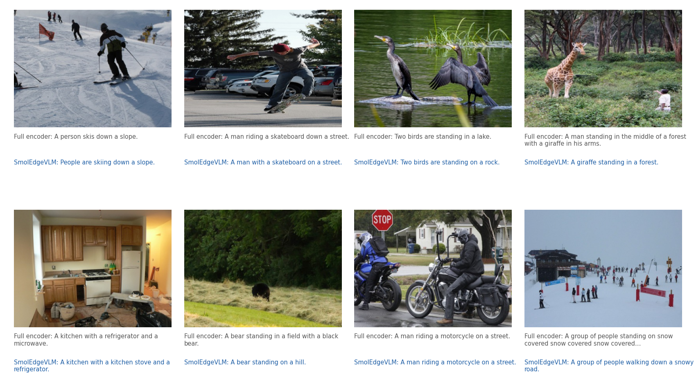
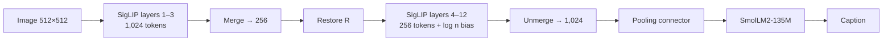

# SmolEdgeVLM: Low-Latency Image Captioning on a 2 GB Edge Device

SmolEdgeVLM shortens the time a small vision-language model takes to start captioning an image. It merges visual
tokens **inside** a frozen SigLIP encoder, then repairs the merged features with a tiny module trained without
captions. It runs on a **Jetson Nano 2 GB**.

**Project page:** https://nikz055.github.io/SmolEdgeVLM-Low-Latency-Image-Captioning-on-a-2-GB-Edge-Device/

<p align="center"></p>

## Problem

On a Jetson Nano 2 GB, a SigLIP + SmolLM2 captioning pipeline waits 2.5 s for the first token, and about 70% of that
wait is the vision encoder. Most token-reduction methods act after the encoder (PruMerge, VisionZip) or inside the
language model (FastV), so they leave the encoder's cost in place. Merging early inside the encoder removes that cost,
but caption quality drops.

## Key contributions

- **Merging inside the encoder.** After SigLIP layer 3, the 1,024 patch tokens are merged into 256. The merge is
  parameter-free: a fixed anchor lattice and local similarity assignment. Layers 4–12 then run on a quarter of the
  tokens.
- **Label-free restoration module R.** It has 0.30 M parameters and is trained only to match the full encoder's
  output, with no captions. It recovers the quality lost by merging.
- **Edge deployment.** A plain-PyTorch runtime for the Jetson Nano's Python 3.6 software stack, measured on the
  device.
- **Cross-model check.** The same step inside the released SmolVLM-256M cuts its TTFT by 45–55%.

## Architecture



SigLIP-B/16@512 and SmolLM2-135M stay frozen. Only R and the connector (1.08 M parameters together, 0.47% of 229 M)
are trained. Inside layers 4–12, a log n attention bias weights each merged token by the number of patches it stands
for (proportional attention). Version 2 adds an optional LoRA adapter on SmolLM2, merged into the Jetson package.
Details: [docs/architecture.md](docs/architecture.md).

## Results

| | Full encoder | SmolEdgeVLM | Change |
|---|---|---|---|
| TTFT, Jetson Nano 2 GB (10 W, 500 COCO test images) | 2.52 s | **1.46 s** | −42% |
| TTFT, Tesla T4 (500 images, 3 seeds) | 113.2 ms | **71.7 ms** | −37% |
| CIDEr-D / CLIPScore, T4 (3 seeds) | 0.791 / 69.0 | 0.786 / 69.3 | no significant difference |
| Captions per minute, Jetson (5-minute sustained run) | 12.5 | **17.3** | +38% |

**Version 2**, retrained on COCO, TextCaps and VizWiz-Captions with LoRA, was compared on the Jetson Nano on the same
100 COCO images as the other models:

| Model | TTFT | Whole caption | CIDEr |
|---|---|---|---|
| **SmolEdgeVLM v2 + LoRA** (16-bit) | 1.50 s | 3.62 s | 1.183 |
| LFM2-VL-450M (8-bit) | 3.35 s | 12.20 s | 1.158 |
| SmolVLM-500M (8-bit) | 3.28 s | 15.59 s | 0.896 |
| GIT-base-COCO, a COCO captioning specialist (16-bit) | 0.44 s | 0.68 s | 1.590 |

v2 ties LFM2-VL-450M on CIDEr (+0.03 [−0.10, +0.15]) at 2.2× lower TTFT. The single-task GIT-base-COCO is faster and
better on COCO. All tables, sources and confidence intervals: [docs/results.md](docs/results.md).

## Installation

```bash
git clone https://github.com/nikz055/SmolEdgeVLM-Low-Latency-Image-Captioning-on-a-2-GB-Edge-Device.git
cd SmolEdgeVLM-Low-Latency-Image-Captioning-on-a-2-GB-Edge-Device
pip install -e ".[dev]"
pytest
```

Full guide, including training, evaluation and development notes: [docs/installation.md](docs/installation.md).

## Usage

```bash
python scripts/caption.py photo.jpg                          # v1: full encoder vs SmolEdgeVLM, with timings
python scripts/caption.py photo.jpg --weights weights/v2     # v2 merged path (without LoRA)
```

```python
from PIL import Image
from smoledgevlm import SmolEdgeVLM

model = SmolEdgeVLM('weights/v1')
print(model.caption(Image.open('photo.jpg'))['caption'])
```

SigLIP and SmolLM2 (about 1.1 GB) download from Hugging Face on first use. For the Jetson Nano, see
[jetson/README.md](jetson/README.md).

## Requirements

| | PC / server | Jetson Nano 2 GB |
|---|---|---|
| Software | Python ≥ 3.9, PyTorch ≥ 1.12, transformers ≥ 4.40 | JetPack 4.6.1 (Python 3.6, CUDA 10.2), PyTorch 1.10, NumPy, Pillow |
| Used for | captioning, training (Tesla T4), evaluation, export | captioning and benchmarking (float16 package, about 425 MB) |

## Repository layout

```
smoledgevlm/        the method: config, merge (no weights), R and connector, model, losses, metrics, COCO splits
scripts/            caption.py, train_restoration.py, train_connector.py, evaluate.py, score_board.py
jetson/             export_for_jetson.py (PC) and the board runtime, benchmark and live camera test
notebooks/          Kaggle notebooks for the v2 retraining and its full-encoder check
weights/v1, v2/     trained R and connectors (7 MB each)
results/            every reported number: v1/, v2/ and the board comparison (jetson_board_100/)
docs/               architecture, results, installation, method details; project page (index.html, static/)
tests/              CPU unit tests (no downloads)
```

## Documentation

- [Architecture](docs/architecture.md): components, data flow, deployment
- [Method and design choices](docs/method.md): what was compared at each step, and why
- [Results](docs/results.md): every table, with its source file
- [Installation and usage](docs/installation.md)
- [Jetson deployment](jetson/README.md) · [v2 notebooks](notebooks/README.md) · [Changelog](CHANGELOG.md)

## Limitations

- Memory is not reduced: the weights are the same, plus 0.30 M for R. The gain is latency.
- Energy per caption was not measured, because the 2 GB board has no power sensor.
- The quality results are for English captioning on COCO, nocaps and TextCaps. In SmolVLM-256M, R does not fully
  protect quality.
- The size bias approximates full attention, and merging loses some detail that R cannot recover.
- LoRA training exists only in the v2 notebook. The LoRA weights and the v2 board package are not in the repository.

## Acknowledgements

Token merging and proportional attention come from ToMe (Bolya et al., ICLR 2023). Unmerging follows ToMe for Stable
Diffusion and DyMU. The project is built on SigLIP (Zhai et al., ICCV 2023) and SmolLM2 (Ben Allal et al., 2025), and
evaluated with CIDEr (Vedantam et al., CVPR 2015) and CLIPScore (Hessel et al., EMNLP 2021) on MS-COCO (Lin et al.,
ECCV 2014).

Developed by **Nikhil Rajiv** as an M.Tech project at Amrita School of Computing, Amrita Vishwa Vidyapeetham, under
the guidance of Dr. A. Baskar.

## License

Code: MIT ([LICENSE](LICENSE)). The SigLIP and SmolLM2 weights are downloaded from their original sources under their
own licenses (Apache 2.0).
