# Architecture

SmolEdgeVLM is a captioning pipeline built from two frozen pretrained models, SigLIP-B/16@512 and SmolLM2-135M.
It reduces the vision encoder's work by merging its tokens **inside** the encoder, after layer 3. Only two small
modules are trained: the restoration module R (0.30 M parameters) and the pooling connector (0.78 M). Version 2 adds
an optional LoRA adapter on SmolLM2, merged into the board package (see [Versions](#versions)).

## Pipeline

```mermaid
flowchart LR
    A["Image<br/>512×512"] --> B["SigLIP patch embedding<br/>+ layers 1–3<br/>1,024 tokens"]
    B --> C["Merge<br/>1,024 → 256 tokens<br/>+ group sizes n"]
    C --> D["Restoration R"]
    D --> E["SigLIP layers 4–12<br/>256 tokens<br/>attention + log n"]
    E --> F["Post-norm, unmerge<br/>256 → 1,024 tokens"]
    F --> G["Pooling connector<br/>2×2 pool + MLP<br/>256 × 576"]
    G --> H["SmolLM2-135M<br/>[visual][prompt]<br/>greedy, KV cache"]
    H --> I["Caption"]
    classDef frozen fill:#f2f2f2,stroke:#7f7f7f;
    classDef free fill:#dce6f2,stroke:#4f81bd;
    classDef trained fill:#fdeada,stroke:#f79646;
    class B,E,H frozen;
    class C,F free;
    class D,G trained;
```

Grey: frozen pretrained weights. Blue: steps with no weights. Orange: trained modules.
The **full-encoder baseline** is the same pipeline with C, D and F switched off (all 12 layers on 1,024 tokens, with its
own connector).

## Components

| Component | Code | Trained | Role |
|---|---|---|---|
| Settings | [`smoledgevlm/config.py`](../smoledgevlm/config.py) | | Model ids, cut layer (3), 256 tokens, 7 × 7 window, R width 192, prompt, generation limit |
| Vision encoder | `SigLIP-B/16@512`, run layer by layer in [`model.py`](../smoledgevlm/model.py) (`layers_to_cut`, `merged_from_cut`, `full_from_cut`) | frozen | 12 transformer layers on a 32 × 32 grid of 16 × 16 patches, width 768 |
| Token merging | [`merge.py`](../smoledgevlm/merge.py) `lattice_anchors`, `TokenMerger` | no weights | Fixed anchor lattice, local similarity assignment, group averaging |
| Size bias | [`merge.py`](../smoledgevlm/merge.py) `size_bias` | no weights | Adds log n to every attention score that points at a merged token |
| Unmerge | [`merge.py`](../smoledgevlm/merge.py) `unmerge` | no weights | Copies each group's output back to its patch positions |
| Restoration R | [`modules.py`](../smoledgevlm/modules.py) `Restore` | yes, 0.30 M | Residual MLP that repairs merged tokens before layer 4 |
| Connector | [`modules.py`](../smoledgevlm/modules.py) `PoolConnector` | yes, 0.78 M | 2 × 2 average pooling to 16 × 16, then Linear(768→576), GELU, Linear(576→576) |
| Language model | `SmolLM2-135M` in [`model.py`](../smoledgevlm/model.py) `caption` | frozen (v2: + LoRA) | Generates the caption from the visual embeddings and the prompt |
| Losses | [`losses.py`](../smoledgevlm/losses.py) | | Stage 1: relative MSE to the full encoder; stage 2: next-token cross-entropy |
| Board runtime | [`jetson/smoledgevlm_jetson.py`](../jetson/smoledgevlm_jetson.py) | | The same maths in plain PyTorch for Python 3.6 / PyTorch 1.10 |

## Data flow (one image, batch 1)

| Step | Operation | Shape |
|---|---|---|
| 1 | Bicubic resize to 512 × 512, scale to [0, 1], normalise (mean 0.5, std 0.5) | 3 × 512 × 512 |
| 2 | Patch embedding + position embedding | 1,024 × 768 |
| 3 | SigLIP layers 1–3 | 1,024 × 768 |
| 4 | **Merge**: 256 anchors, every other patch joins one anchor; average each group, keep its size n | 256 × 768, n ∈ ℕ²⁵⁶ (Σn = 1,024) |
| 5 | **R**: m' = m + W₂ GELU(W₁ LN(m)) | 256 × 768 |
| 6 | SigLIP layers 4–12, each attention softmax(QKᵀ/√d + log n) V | 256 × 768 |
| 7 | Post-layernorm, then **unmerge**: y_i = z_a(i) | 1,024 × 768 |
| 8 | **Connector**: 2 × 2 average pooling, MLP | 256 × 576 |
| 9 | SmolLM2 prefill on [256 visual embeddings][7 prompt tokens] | 263 × 576 |
| 10 | Greedy decoding with a KV cache until EOS or the token limit (24 for the T4 results, 40 on the board) | caption |

The prompt is `Describe this image in one sentence.`, placed after the visual embeddings with no chat template.

## Token reduction, restoration and unmerging

**Anchors.** 256 existing token positions on a fixed 16 × 16 lattice (every second row and column). The lattice is
computed once; no scoring pass is needed.

**Assignment.** Each of the other 768 patches joins the anchor it is most similar to (cosine similarity of the layer-3
features), searching only anchors within 3 patches in each direction (a 7 × 7 window). Every patch belongs to exactly
one group, so nothing is dropped. Group sizes vary per image.

**Merge.** Each group is averaged into one token. Its size n is kept for the attention bias.

**Restoration R.** Averaged tokens are out of distribution for the frozen layers 4–12. R corrects each merged token
with a small residual MLP (768 → 192 → 768) whose output layer starts at zero, so it begins as the identity. R sees
only the merged token.

**Size bias (proportional attention).** In layers 4–12, log n is added to the attention score of every key token.
After the softmax a token that stands for n patches carries n times the weight, as if all n patches were present.
In `model.py` the bias is passed to each Hugging Face SigLIP layer as its additive `attention_mask`; the board runtime
adds it to the scores directly.

**Unmerge.** After the post-layernorm each group's output is copied to all of its patch positions. The connector
therefore sees the usual 32 × 32 grid in both pipelines.

## Vision encoder and language model

SigLIP and SmolLM2 were not trained together and both stay frozen. The connector is the only bridge between them:
it maps the 1,024 encoder tokens to 256 embeddings in SmolLM2's input space (width 576). These are concatenated in
front of the embedded prompt, and SmolLM2 runs on the sequence as if they were word embeddings.

## Training

| Stage | Trains | Loss | Script |
|---|---|---|---|
| 1 | R | relMSE(U, F) + relMSE(pool U, pool F), where F is the full encoder's output and U the merged path's; no captions | [`scripts/train_restoration.py`](../scripts/train_restoration.py) |
| 2 | Connector | Next-token cross-entropy through the frozen SmolLM2 (teacher forcing) | [`scripts/train_connector.py`](../scripts/train_connector.py) |
| v2 only | LoRA on SmolLM2 | Next-token cross-entropy, connector and R frozen | [`notebooks/retrain_v2_kaggle.ipynb`](../notebooks/retrain_v2_kaggle.ipynb) |

relMSE(A, B) = mean((A − B)²) / Var(B). Gradients pass through the frozen layers 4–12, but only R is updated.
Design choices behind each stage are in [method.md](method.md).

## Versions

| | v1 | v2 |
|---|---|---|
| Training data | COCO train2014 (R: 3,000 images; connector: 5,000 images, one caption each) | 127,602 images: COCO train2014, TextCaps, VizWiz-Captions; 30% of steps with darkened, blurred, noisy or compressed copies |
| Trained parts | R, connector (merged and full-encoder) | R, merged-path connector, LoRA (rank 16, alpha 32, on all attention and MLP projections of SmolLM2) |
| Encoder, LM, merge | unchanged | unchanged |
| Weights in this repo | [`weights/v1/`](../weights/v1) | [`weights/v2/`](../weights/v2): R and connector only |
| LoRA | | Merged into SmolLM2 inside the board package written by the notebook; **not** in the Python package and not in this repo |

The Python package runs v1 and v2 without LoRA. Results with LoRA come from the board package.

## Deployment on the Jetson Nano 2 GB

JetPack 4.6.1 ships Python 3.6, which current `transformers` does not support. The board therefore runs a
self-contained re-implementation:

- [`export_for_jetson.py`](../jetson/export_for_jetson.py) (on a PC) writes all weights to one float16 `.npz` file
  (about 425 MB) and a JSON file with the model sizes, the prompt token ids and a byte table for decoding.
- [`smoledgevlm_jetson.py`](../jetson/smoledgevlm_jetson.py) needs only PyTorch, NumPy and Pillow. To save memory it
  avoids cuDNN: the patch embedding is a reshape plus one linear layer. Tensors load one at a time to keep peak memory
  low. It also implements SigLIP's tanh GELU, SmolLM2's RMSNorm, RoPE, grouped-query attention and a KV cache.
- It was checked against `model.py` before any timing (encoder outputs within about 2e-6 in float32, identical
  captions). The export can store reference captions, and the benchmark reports how many board captions match them.
- Memory is not reduced, because the weights are the same plus R. The gain is latency: layers 4–12 run on 256
  instead of 1,024 tokens (1,325 ms → 251 ms on the board at 10 W).

Running on the board: [jetson/README.md](../jetson/README.md).
